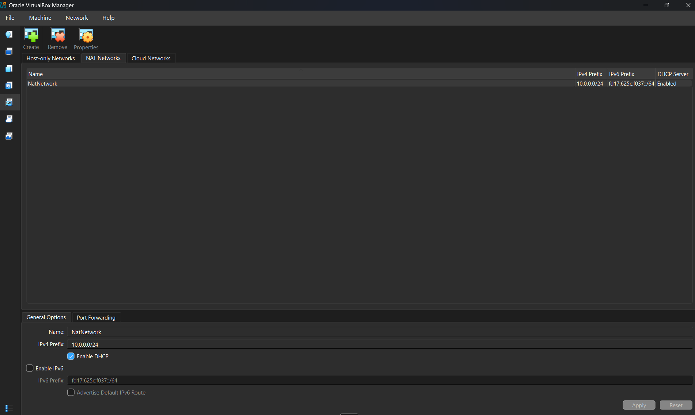

 <div align="center">

# 🔐 Cybersecurity Lab Setup & SOC Investigation

**Designing a virtual penetration-testing environment and performing practical network security investigations.**


</div>

---

## 📌 01. Project Overview

This project documents the setup of a personal cybersecurity testing environment using Oracle VirtualBox and Kali Linux, followed by practical network security investigations using Wireshark.

The virtual laboratory was configured with a dedicated NAT Network, static IP addressing, internet connectivity, and host-to-guest integration. The environment provides a foundation for learning penetration testing, network reconnaissance, vulnerability assessment, and other ethical hacking techniques.

In addition to the infrastructure setup, six practical SOC investigation labs were completed. These exercises involved analyzing captured network traffic to identify attackers, reconstruct TCP communication, discover exposed credentials, detect brute-force attempts, and investigate suspicious VoIP calls.

## 🎯 02. Implementation Objectives

The primary goals of this project were:

- Establish a working cybersecurity laboratory using VirtualBox.
- Deploy Kali Linux as the primary security testing machine.
- Configure a custom NAT Network using the `10.0.0.0/24` subnet.
- Assign a static IPv4 address to Kali Linux.
- Enable internet access and DNS resolution.
- Configure clipboard, drag-and-drop, and shared-folder functionality.
- Create a recoverable VM snapshot.
- Perform practical network traffic investigations using Wireshark.
- Develop foundational skills in SOC analysis and threat identification.

---

## 🏗️ 03. Virtual Lab Architecture

The environment consists of a Windows host system running Oracle VirtualBox, with Kali Linux operating as a guest virtual machine.

A custom NAT Network provides connectivity to the virtual machines while allowing outbound internet access.

### Network Design

```text
                    INTERNET
                       |
                       |
                WINDOWS 10 HOST
                 8 GB RAM / i7
                       |
                       |
                ORACLE VIRTUALBOX
                    v7.2
                       |
                       |
                 NAT NETWORK
                  NatNetwork
                  10.0.0.0/24
                       |
                       |
                  KALI LINUX
                   10.0.0.2
                       |
                SECURITY TESTING
                       |
             ADDITIONAL TARGET VMs
                (Future Expansion)
```

### Planned Virtual Machine Address Allocation

| Virtual Machine | IPv4 Address | Purpose |
|---|---|---|
| Kali Linux | `10.0.0.2` | Security testing machine |
| Windows 10/11 | `10.0.0.7` | Client testing |
| Additional VM | `10.0.0.9` | Target environment |
| Windows Server 2016 | `10.0.0.10` | Server testing |
| Additional VM | `10.0.0.11` | Target environment |
| Additional VM | `10.0.0.16` | Target environment |

*The additional target machines are planned lab allocations and are not represented as already deployed.*

---

## ⚙️ 04. System & Network Specifications

### Host and Virtualization Environment

| Component | Configuration |
|---|---|
| Host Operating System | Windows 10 |
| System RAM | 8 GB |
| Processor | Intel Core i7 |
| Hypervisor | Oracle VirtualBox 7.2 |
| Archive Utility | 7-Zip |
| Guest Operating System | Kali Linux 2026.3 |
| Kali VM Memory | 2048 MB |
| Network Adapter | Intel PRO/1000 MT Desktop |

### NAT Network Configuration

| Parameter | Value |
|---|---|
| Network Name | NatNetwork |
| Network Type | NAT Network |
| IPv4 Prefix | `10.0.0.0/24` |
| Subnet Mask | `255.255.255.0` |
| DHCP Server | Enabled |
| IPv6 | Disabled |
| Kali Static IP | `10.0.0.2/24` |
| Default Gateway | `10.0.0.1` |
| DNS Server | `8.8.8.8` |
| Planned Additional VM Range | `10.0.0.3 – 10.0.0.99` |

---

## 🛠️ 05. Environment Implementation

### 5.1 Preparing the Virtualization Environment

Installed 7-Zip to handle compressed virtual machine packages and Oracle VirtualBox as the primary virtualization platform.

Software resources:

- [7-Zip](https://7-zip.org/download.html)
- [Oracle VirtualBox](https://virtualbox.org/wiki/Downloads)

### 5.2 Creating the Virtual Network

Created a dedicated NAT Network through VirtualBox Network Manager.

The network was configured with the following parameters:

```text
Network Name : NatNetwork
IPv4 Prefix  : 10.0.0.0/24
DHCP         : Enabled
IPv6         : Disabled
```

<details>
<summary>View NAT Network configuration screenshot</summary>



</details>

The NAT Network configuration allows connected virtual machines to communicate with one another and access external networks through network address translation.

### 5.3 Deploying Kali Linux

Downloaded the Kali Linux 2026.3 VirtualBox image from the official Kali Linux website and imported it into VirtualBox.

Virtual machine configuration:

```text
Operating System : Kali Linux 2026.3
Memory           : 2048 MB
Network Adapter  : Adapter 1
Attached To      : NAT Network
Network Name     : NatNetwork
Adapter Type     : Intel PRO/1000 MT Desktop
```

The virtual machine was successfully started and the Kali Linux desktop environment was accessed.


Official download: https://www.kali.org/get-kali/

### 5.4 Configuring Static IPv4 Addressing

Configured the Kali Linux network connection manually using NetworkManager.

The following IPv4 parameters were applied:

```text
Method       : Manual
IP Address   : 10.0.0.2
Netmask      : 24
Gateway      : 10.0.0.1
DNS Server   : 8.8.8.8
```

<details>
<summary>View Kali Linux IPv4 configuration screenshot</summary>


</details>

This configuration establishes a consistent network address for the Kali Linux machine.

### 5.5 Enabling Host-to-Guest Integration

Configured VirtualBox integration features to simplify interaction and file exchange between Windows and Kali Linux.

| Feature | Configuration |
|---|---|
| Shared Clipboard | Bidirectional |
| Drag and Drop | Bidirectional |
| Shared Folder | Enabled |
| Host Folder | `/downloads` |
| Auto-mount | Enabled |
| Make Permanent | Enabled |

The shared folder provides a convenient way to transfer files between the host operating system and the virtual machine.

### 5.6 Creating a Recovery Snapshot

After completing the initial virtual machine configuration, created a baseline snapshot.

```text
Snapshot Name:
Clean Kali - Network Setup
```

This snapshot preserves the initial configured state and provides a recovery point before subsequent security experiments.

---

## 🔎 06. Network Configuration Verification

After configuring the virtual network and Kali Linux, the following commands were used to inspect and test the network environment.

### Check IP Configuration

```bash
ip a
```

### Inspect Routing Information

```bash
ip route
```

### Test Gateway Connectivity

```bash
ping -c 4 10.0.0.1
```

### Test Internet Connectivity

```bash
ping -c 4 8.8.8.8
```

### Verify DNS Resolution

```bash
nslookup networkwalks.com
```

### Check Nmap Installation

```bash
nmap --version
```

These checks were used to examine IP configuration, routing, gateway communication, internet connectivity, DNS resolution, and the availability of Nmap.

---

## 🐞 07. Troubleshooting & Issues Resolved

During the lab configuration, two important issues were encountered and resolved.

### Issue 1: Kali Linux Internet Connectivity

After configuring a manual IPv4 address, internet connectivity issues occurred in the Kali Linux virtual machine.

This issue was addressed using the NetworkManager Duplicate Address Detection timeout configuration.

The following commands were executed:

**Step 1 — Modify the DAD timeout**

```bash
sudo nmcli connection modify "Wired connection 1" ipv4.dad-timeout 0
```

**Step 2 — Restart the network connection**

```bash
sudo nmcli connection down "Wired connection 1"
```

**Step 3 — Bring the connection back up**

```bash
sudo nmcli connection up "Wired connection 1"
```

After executing these commands, the Kali Linux network connection was restarted and connectivity was checked again.

The workaround is relevant to the NetworkManager configuration used in the lab. The connection name may differ on other installations.

### Issue 2: VirtualBox Hardware Virtualization Error

The Kali Linux virtual machine initially encountered a startup issue related to hardware virtualization.

The issue was resolved by enabling Intel VT-x through the computer's BIOS/UEFI configuration.

**Resolution steps:**

1. Restarted the computer.
2. Entered the BIOS/UEFI settings.
3. Located the processor or virtualization configuration.
4. Enabled Intel VT-x / hardware virtualization.
5. Saved the configuration.
6. Restarted Windows.
7. Started the Kali Linux virtual machine again.

After enabling hardware virtualization, the virtual machine started successfully.

---

## 🕵️ 08. SOC Analyst – Wireshark Investigation

Alongside the virtual lab implementation, completed six browser-based network investigation labs.

Each investigation consisted of ten tasks and focused on a specific network security scenario.

### Lab 01 — Identifying the Attacker's IP Address

**Objective:** Investigate captured network traffic to identify the IP address associated with suspicious activity.

**Technical focus:**
- Source and destination IP analysis
- Packet inspection
- Suspicious communication identification

[Access Lab 3](https://networkwalks.com/wireshark-lab3/)

### Lab 02 — TCP Stream Analysis: Part 1

**Objective:** Reconstruct TCP communication and inspect the information exchanged between network endpoints.

**Technical focus:**
- TCP packet analysis
- Follow TCP Stream
- Conversation reconstruction

[Access Lab 4](https://networkwalks.com/wireshark-lab4/)

### Lab 03 — TCP Stream Analysis: Part 2

**Objective:** Examine another network capture to identify hidden information transmitted through TCP communication.

**Technical focus:**
- TCP stream inspection
- Data reconstruction
- Hidden information investigation

[Access Lab 5](https://networkwalks.com/wireshark-lab5/)

### Lab 04 — HTTP Plain-Text Credential Investigation

**Objective:** Investigate unencrypted HTTP traffic to identify exposed usernames and passwords.

**Technical focus:**
- HTTP request analysis
- POST request inspection
- Plain-text credential identification

[Access Lab 6](https://networkwalks.com/wireshark-lab6/)

### Lab 05 — Detecting a Brute-Force Attacker

**Objective:** Analyze repeated login attempts and identify the source responsible for suspicious authentication activity.

**Technical focus:**
- Authentication traffic analysis
- Repeated login attempts
- Source IP investigation
- Brute-force detection

[Access Lab 7](https://networkwalks.com/wireshark-lab7/)

### Lab 06 — VoIP Call Investigation

**Objective:** Investigate captured voice communication and identify the suspicious caller involved in the recorded call.

**Technical focus:**
- VoIP packet analysis
- Call reconstruction
- Audio investigation
- Suspicious communication identification

[Access Lab 8](https://networkwalks.com/wireshark-lab8/)

### Investigation Completion Summary

| No. | Investigation | Tasks |
|---|---|---:|
| 01 | Attacker IP Identification | 10 |
| 02 | TCP Stream Analysis – Part 1 | 10 |
| 03 | TCP Stream Analysis – Part 2 | 10 |
| 04 | HTTP Credential Investigation | 10 |
| 05 | Brute-Force Detection | 10 |
| 06 | VoIP Scam Investigation | 10 |
| | **Total** | **60** |

---

## 💡 09. Technical Knowledge & Learning Outcomes

The implementation and investigation exercises provided practical exposure to several cybersecurity concepts.

### Virtualization and System Administration
- Virtual machine deployment and configuration.
- VirtualBox network management.
- Kali Linux administration.
- BIOS/UEFI hardware virtualization.
- VM snapshots and recovery.

### Networking Fundamentals
- IPv4 addressing and subnetting.
- NAT versus NAT Network.
- Static IP configuration.
- Default gateways and DNS.
- Network connectivity troubleshooting.

### Network Security and SOC Operations
- Packet inspection using Wireshark.
- TCP communication reconstruction.
- HTTP traffic investigation.
- Clear-text credential exposure.
- Brute-force activity identification.
- VoIP traffic investigation.
- Basic network threat analysis.

---

## 🔐 10. Security & Ethical Guidelines

This environment is designed for educational purposes, cybersecurity experimentation, and authorized security testing.

- Perform testing only on systems you own or have permission to assess.
- Keep intentionally vulnerable machines within controlled lab networks.
- Do not expose vulnerable virtual machines directly to public networks.
- Do not inspect or capture third-party network traffic without authorization.

---

## 📚 11. Tools & Learning Resources

| Resource | Official Website |
|---|---|
| 7-Zip | https://7-zip.org/ |
| Oracle VirtualBox | https://virtualbox.org/ |
| Kali Linux | https://kali.org/ |
| Wireshark | https://wireshark.org/ |
| Networkwalks | https://networkwalks.com/ |

---

## 👨‍💻 12. Project Information

| Attribute | Details |
|---|---|
| Project Name | Cybersecurity Lab & SOC Investigation |
| Project Domain | Cybersecurity |
| Virtualization Platform | Oracle VirtualBox 7.2 |
| Security Distribution | Kali Linux 2026.3 |
| Network Configuration | NAT Network |
| IPv4 Subnet | `10.0.0.0/24` |
| Primary Lab Machine | Kali Linux |
| Network Analysis Tool | Wireshark |
| SOC Investigation Labs | 6 |
| Total Investigation Tasks | 60 |

---

<div align="center">

### Explore. Analyze. Understand. Secure.

**A practical journey into virtual cybersecurity environments and network security investigations.**

</div>
